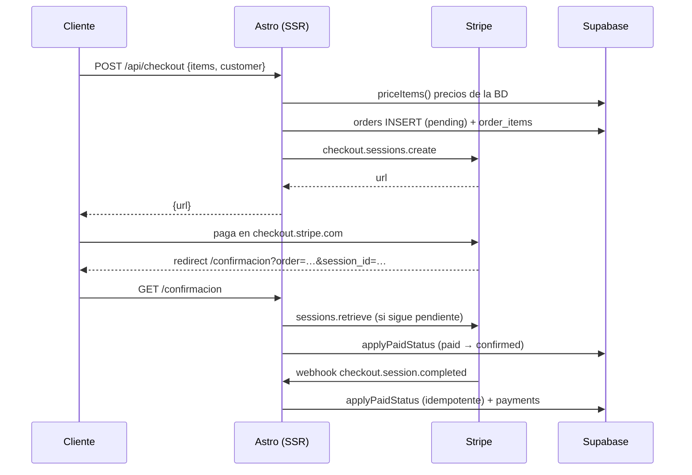

# Pago con Stripe (Checkout alojado)

La tarjeta **nunca** pasa por la tienda: el formulario del checkout recoge solo
datos de contacto/envío y el cobro se captura en el dominio de Stripe (PCI SAQ A).

## Flujo



## Endpoints

| Ruta | Qué hace |
|---|---|
| `POST /api/checkout` | Valida carrito, crea pedido en `pending` y devuelve la URL de Stripe. |
| `POST /api/webhooks/stripe` | Valida la firma `Stripe-Signature` y aplica el pago. |

Eventos a suscribir en Stripe → Developers → Webhooks:

- `checkout.session.completed`
- `checkout.session.async_payment_succeeded`
- `checkout.session.async_payment_failed`
- `checkout.session.expired`
- `payment_intent.payment_failed`
- `charge.refunded`

URL local de pruebas:

```
stripe listen --forward-to localhost:4321/api/webhooks/stripe
```

## Variables de entorno

Ver `storefront/env.stripe.example`. En Vercel, preview y production:

- `STRIPE_SECRET_KEY`
- `PUBLIC_STRIPE_PUBLISHABLE_KEY`
- `STRIPE_WEBHOOK_SECRET`
- `SUPABASE_SERVICE_ROLE_KEY`

## SQL

Correr una vez en Supabase → SQL Editor:

```
scripts/stripe_checkout.sql
```

Agrega `orders.payment_reference` y el índice por `provider_transaction_id`.

## Modo prueba

Con `sk_test_…` no se mueve dinero. Las tarjetas de prueba son números válidos
(Luhn + BIN real) pero la autorización la simula Stripe:

- `4242 4242 4242 4242` → aprobada
- `4000 0000 0000 0002` → rechazada
- `4000 0027 6000 3184` → exige 3D Secure

También sirve una tarjeta real: no se cobra.

Para pasar a producción: verificar la empresa en Stripe, activar pagos en vivo,
crear un **nuevo** webhook con las llaves live y cambiar las tres variables en
Vercel. El código no cambia.
