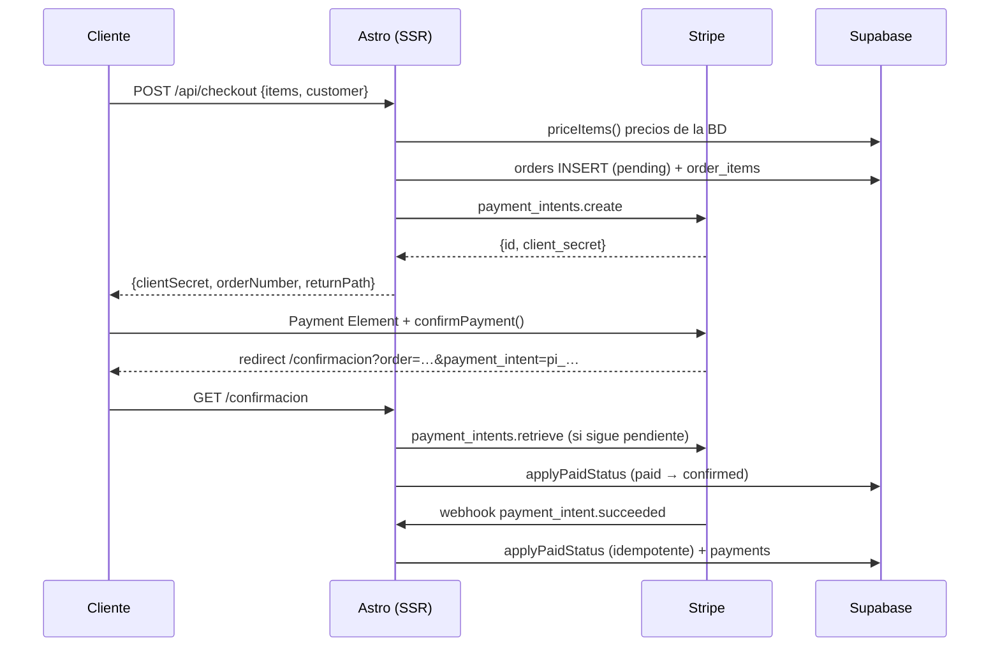

# Pago con Stripe (Payment Element embebido)

La tarjeta **nunca** pasa por la tienda: el Payment Element se monta dentro del
checkout y el formulario de la tarjeta vive en un iframe de Stripe (PCI SAQ A).
No hay redirección a `checkout.stripe.com` ni ventana emergente.

## Flujo



## Endpoints

| Ruta | Qué hace |
|---|---|
| `POST /api/checkout` | Valida carrito, crea pedido en `pending` y devuelve `clientSecret` del PaymentIntent. |
| `POST /api/webhooks/stripe` | Valida la firma `Stripe-Signature` y aplica el pago. |

Eventos a suscribir en Stripe → Developers → Webhooks:

- `payment_intent.succeeded`
- `payment_intent.payment_failed`
- `checkout.session.completed` (compatibilidad con pagos antiguos)
- `checkout.session.async_payment_succeeded`
- `checkout.session.async_payment_failed`
- `checkout.session.expired`
- `charge.refunded`
- `refund.created` / `refund.updated`

URL local de pruebas:

```
stripe listen --forward-to localhost:4321/api/webhooks/stripe
```

## Variables de entorno

Stripe tiene **dos ranuras** (test y live) y un interruptor. Así se puede
guardar la llave de producción sin borrar la de pruebas:

| Variable | Tipo | Para qué |
|---|---|---|
| `PUBLIC_STRIPE_ENV` | público (build) | `live` o `test`. Elige la ranura. |
| `STRIPE_SECRET_KEY_LIVE` | secreto (runtime) | `sk_live_…` o `rk_live_…` |
| `STRIPE_SECRET_KEY_TEST` | secreto (runtime) | `sk_test_…` o `rk_test_…` |
| `PUBLIC_STRIPE_PUBLISHABLE_KEY_LIVE` | público (build) | `pk_live_…` |
| `PUBLIC_STRIPE_PUBLISHABLE_KEY_TEST` | público (build) | `pk_test_…` |
| `STRIPE_WEBHOOK_SECRET_LIVE` | secreto (runtime) | firma del endpoint live |
| `STRIPE_WEBHOOK_SECRET_TEST` | secreto (runtime) | firma del endpoint de pruebas |

Respaldo: si una ranura no existe, se usa la variable genérica
(`STRIPE_SECRET_KEY`, `PUBLIC_STRIPE_PUBLISHABLE_KEY`, `STRIPE_WEBHOOK_SECRET`).
Si `PUBLIC_STRIPE_ENV` no está, el entorno se deduce del prefijo de la llave.

El switch lo resuelve `lib/stripe.ts` (`stripeEnv`, `stripeSecretKey`,
`stripePublishableKey`, `stripeWebhookSecret`). `stripeMode()` sigue leyendo el
prefijo real de la llave: es la fuente de verdad de lo que se está cobrando.

### Pasar a producción

1. Stripe → Developers → API keys → **Reveal live key** → `sk_live_…` (o una
   *restricted key* `rk_live_…`, ver abajo). Copia también `pk_live_…`.
2. Stripe → Developers → Webhooks → **Add endpoint** con la URL
   `https://www.dinerosobreproblemas.com/api/webhooks/stripe`, los mismos
   eventos que el de pruebas, y copia su `whsec_…`.
3. Vercel → Settings → Environment Variables (scope **Production**):
   `STRIPE_SECRET_KEY_LIVE`, `PUBLIC_STRIPE_PUBLISHABLE_KEY_LIVE`,
   `STRIPE_WEBHOOK_SECRET_LIVE` y `PUBLIC_STRIPE_ENV=live`.
4. **Redeploy** (las `PUBLIC_*` se graban en el build).
5. Probar una compra real de bajo importe y verificar en Stripe → Payments que
   el cargo aparezca en modo **live**.

Volver a pruebas: `PUBLIC_STRIPE_ENV=test` y redeploy. No hay que borrar nada.

## Reembolsos

Cuando devuelves dinero desde Stripe, el pedido se actualiza solo
(`payment_status = refunded`, `status = returned`) al llegar estos eventos al
webhook:

- `charge.refunded` — reembolso total hecho desde el dashboard o la API
- `refund.created` / `refund.updated` — reembolsos parciales o asíncronos

**El endpoint live tiene que estar suscrito a esos eventos.** Si solo marcas
`checkout.session.*`, el pago entra pero el reembolso nunca llega y el pedido se
queda en “Aprobado”.

El pedido se busca primero en `payments.provider_transaction_id` y, si esa fila
no existe, por `orders.payment_reference` con el mismo `pi_…`.

### Reconciliar a mano

Si un reembolso no llegó (webhook caído, endpoint mal configurado), en
`/admin/pedidos` el pedido tiene el botón **Marcar reembolsado**: solo cambia el
estado en el panel, no devuelve dinero.

## SQL

Correr una vez en Supabase → SQL Editor:

```
scripts/stripe_checkout.sql
```

Agrega `orders.payment_reference` y el índice por `provider_transaction_id`.

## Llaves restringidas (`rk_live_…`)

Una `rk_live_…` funciona igual que una `sk_live_…`: el código acepta ambos
prefijos como producción (`isLiveKey` en `lib/stripe.ts`). La diferencia es que
tú eliges los permisos, así que la llave debe incluir como mínimo:

- **Checkout Sessions**: Write (crear la sesión) y Read (consultarla al volver)
- **Coupons**: Write (descuentos de un solo uso)

No se necesitan permisos de Customers, Products ni Refunds: el producto viaja
como `price_data` en la sesión y los reembolsos los avisa el webhook de Stripe.

## Modo prueba

Con `sk_test_…` no se mueve dinero. Las tarjetas de prueba son números válidos
(Luhn + BIN real) pero la autorización la simula Stripe:

- `4242 4242 4242 4242` → aprobada
- `4000 0000 0000 0002` → rechazada
- `4000 0027 6000 3184` → exige 3D Secure

También sirve una tarjeta real: no se cobra.

Para volver a pruebas basta `PUBLIC_STRIPE_ENV=test` y redeploy (ver arriba);
las variables `_TEST` o las genéricas siguen ahí.
